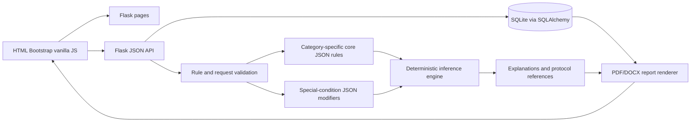

# ERPilot AI

ERPilot AI is a deterministic, rule-based trauma-assessment and checklist
prototype. It records explicit evidence, evaluates source-referenced JSON
rules, keeps unknown evidence distinct from confirmed absence, and produces
explainable assessment results and downloadable reports.

**ERPilot is an educational prototype. It is not clinically validated, does
not diagnose patients, is not intended for real-patient care, and does not
replace qualified clinical judgment.**

## Purpose and intended users

The prototype is designed to support structured demonstration and review of
trauma-assessment evidence. Intended users in the product requirements are
emergency nurses, first responders, junior or on-call doctors, and faculty or
administrative reviewers. Patients are not direct users.

The implementation covers four core trauma categories:

- Brain trauma
- Chest trauma
- Abdominal trauma
- Orthopedic trauma

It also evaluates four additive special-condition modifiers:

- Pregnancy
- Anticoagulant treatment
- Opioid intoxication documented or suspected
- Documented anaesthesia allergy

The modifiers do not replace or rewrite core outcomes. `RED`, `ORANGE`,
`YELLOW`, and `GREEN` are provisional ERPilot software-display priorities, not
validated clinical triage classifications.

## Implemented features

- Patient registration with SQLite persistence.
- Category-specific JSON rule loading and deterministic forward chaining.
- Backward-chaining support for supported conclusions.
- Explicit `PRESENT`, `ABSENT`, and `UNKNOWN` evidence states.
- `FULL_MATCH`, `PARTIAL_MATCH`, and explicit `NO_MATCH` results.
- Rule explanations containing rule IDs, matched conditions, and protocol
  references.
- Additive special-condition modifier evaluation.
- Persisted evidence, vitals, inference results, explanations, and modifier
  results.
- Downloadable PDF and DOCX assessment reports.
- Accessible RED-priority result alert.
- Flask JSON APIs and a Bootstrap/vanilla-JavaScript interface.

The optional read-only rule viewer is not implemented. Historical assessment
search, authentication, EHR integration, live notifications, and clinical
decision validation are outside the current scope.

## Architecture



## Technology stack

- Python 3.11.9 verified in the development environment. No project file
  declares a narrower or wider supported range.
- Flask 3.1.3
- Flask-SQLAlchemy and SQLAlchemy
- SQLite
- JSON rule and knowledge-base files
- ReportLab for PDF output
- `python-docx` for DOCX output
- HTML, CSS, Bootstrap, and vanilla JavaScript
- pytest

## Repository structure

```text
app.py                         Flask application factory and page routes
config.py                      Local development configuration
reporting.py                   PDF/DOCX report preparation and rendering
requirements.txt               Runtime and test dependencies
knowledge_base/
  departments.json             Department catalog
  protocols.md                 Protocol research notes and limitations
  symptoms.json                Canonical evidence vocabulary
rule_base/
  core/*.json                  Category-specific core rules
  special_conditions/*.json    Additive modifier rules
  rule_schema.md               JSON schema and evidence conventions
inference_engine/              Matching, chaining, validation, explanations
models/                        Patient, assessment, and database models
routes/triage.py               Patient, triage, and report API routes
templates/                     Flask page templates
static/                        Browser JavaScript and CSS
tests/                         Unit, integration, frontend-contract, and report tests
docs/                          Requirements, knowledge, final report, and demo guide
```

## Setup on Windows

From the repository root in PowerShell:

```powershell
py -3.11 -m venv .venv
.\.venv\Scripts\Activate.ps1
python -m pip install --upgrade pip
python -m pip install -r requirements.txt
python -m playwright install chromium
```

Playwright's Python package and its Chromium browser are installed separately.
The browser-install command downloads the Chromium binary used by the browser
tests.

If PowerShell blocks activation, run:

```powershell
Set-ExecutionPolicy -Scope Process -ExecutionPolicy Bypass
.\.venv\Scripts\Activate.ps1
```

Initialize the local SQLite schema once:

```powershell
python -c "from app import app; from models.db import db; app.app_context().push(); db.create_all(); print('database initialized')"
```

Start the development server:

```powershell
python -m flask --app app run --debug
```

Then open <http://127.0.0.1:5000/>.

This debug server is for local demonstrations only; do not expose it to an
untrusted network.

The application uses a development-only fallback secret key. To set a local
secret explicitly, configure `ERPILOT_SECRET_KEY` before starting the server:

```powershell
$env:ERPILOT_SECRET_KEY = "replace-with-a-local-development-value"
```

There is no authentication or authorization system in this prototype.

## Setup on macOS/Linux

The same application can be run with Python 3.11 or another compatible Python
3 interpreter:

```bash
python3 -m venv .venv
. .venv/bin/activate
python -m pip install --upgrade pip
python -m pip install -r requirements.txt
python -m playwright install chromium
python -c "from app import app; from models.db import db; app.app_context().push(); db.create_all(); print('database initialized')"
python -m flask --app app run --debug
```

The project has no operating-system-specific application code. The commands
above are setup instructions; they have been checked against the Flask app and
dependency manifests in this repository.

## Verification commands

Run the complete test suite:

```text
python -m pytest -q
```

Run Python compilation checks:

```text
python -m compileall -q .
```

Install Playwright's Chromium browser and run the real-browser workflows:

```text
python -m playwright install chromium
python -m pytest -q tests/test_browser_workflows.py
```

Check JavaScript syntax:

```text
node --check static/js/assessment.js
node --check static/js/results.js
node --check static/js/questions.js
node --check static/js/registration.js
```

Check whitespace errors:

```text
git diff --check
```

The Stage 9 final verification run reported `147 passed`, including five
Playwright Chromium workflows. Run the browser workflow file separately when
you need a distinct browser-test result:

```text
python -m pytest -q tests/test_browser_workflows.py
```

## Application workflow

1. Open `/register` and register a fictional demonstration patient.
2. Open `/assessment`, select one of the four supported categories, and record
   evidence states and optional numeric vitals.
3. Record documented or clinician-suspected modifier evidence separately.
4. Submit the assessment. The API stores the assessment and returns the
   complete inference result.
5. Review `/results` for outcome, rule IDs, conditions, explanations, protocol
   references, modifier flags, and any provisional RED alert.
6. Use the PDF and DOCX links on the results page. The links include both the
   patient ID and assessment ID; the API verifies their association.

See [docs/demo_guide.md](docs/demo_guide.md) for a reproducible walkthrough.

## API endpoints

### Register a patient

`POST /api/patients`

```json
{
  "name": "Demo Patient",
  "age": 35,
  "gender": "unspecified",
  "incident_type": "fall"
}
```

### Create an assessment

`POST /api/triage`

```json
{
  "patient_id": 1,
  "category": "brain_trauma",
  "evidence": {
    "adult_head_injury_post_traumatic_seizure": "PRESENT"
  },
  "modifier_evidence": {
    "pregnancy_status_documented_pregnant": "UNKNOWN"
  },
  "vitals": {
    "heart_rate": 88
  }
}
```

Evidence states are uppercase `PRESENT`, `ABSENT`, or `UNKNOWN`. The triage
route validates category-specific core keys, special-condition keys, and
finite numeric vitals. There is no general assessment retrieval endpoint;
the submitted response is persisted and is used by the results page.

### Download a report

```text
GET /api/patients/<patient_id>/assessments/<assessment_id>/report/pdf
GET /api/patients/<patient_id>/assessments/<assessment_id>/report/docx
```

The routes return `application/pdf` or
`application/vnd.openxmlformats-officedocument.wordprocessingml.document`.
Missing assessments and mismatched patient/assessment associations return
404 without exposing report contents.

## Knowledge and rule documentation

- [Requirement analysis](docs/requirement_analysis.md)
- [Knowledge acquisition and rule derivation](docs/knowledge_acquisition_and_rule_derivation.md)
- [Final report](docs/final_report.md)
- [Demonstration guide](docs/demo_guide.md)
- [Rule schema](rule_base/rule_schema.md)
- [Protocol research notes](knowledge_base/protocols.md)

The rule files and `knowledge_base/symptoms.json` are the data sources of
truth. Use the validator and add regression tests before changing them. The
knowledge-acquisition document records source limitations and unresolved
research gaps rather than concealing them.

## Security, privacy, and clinical limitations

- This prototype has no authentication or authorization.
- Patient and assessment data are stored in a local SQLite database.
- Report access checks the patient-assessment association but is not a
  substitute for authentication.
- Do not use real patient information in demonstrations or tests.
- The rules are educational software mappings, not clinical diagnoses,
  treatment instructions, or validated triage categories.
- Source references and implementation assumptions require qualified clinical
  review before any real-world use.

## Contributing and updating rules

1. Update the relevant JSON dataset and, when needed, the canonical symptom
   vocabulary.
2. Use the exact schema in [rule_schema.md](rule_base/rule_schema.md).
3. Add an authoritative protocol reference and document the mapping in
   [protocols.md](knowledge_base/protocols.md).
4. Run the appropriate validator and add tests for full, partial, no-match,
   unknown, invalid, and persistence behavior.
5. Run the complete verification commands before review.

Do not add a rule based only on a general source index, an unsupported
threshold, or an inferred clinical outcome.
